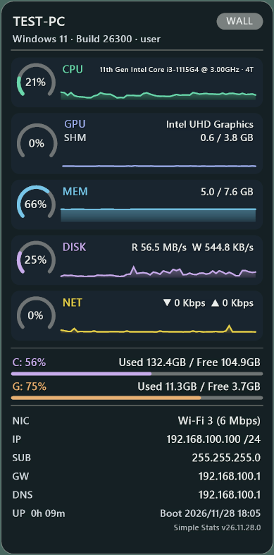

# Simple Stats

[/black)](https://chililikobo.github.io/en/simple-stats.html)

[English](#english) | [日本語](#日本語)

---

## English

Simple Stats is an ultra-lightweight, standalone desktop telemetry HUD for Windows that visualizes real-time PC resource metrics and network diagnostics in a sleek, non-intrusive widget.

### Key Features
- **High-Precision Monitoring & 60s Sparklines**: Visualizes Task Manager-aligned CPU utility (`PDH % Processor Utility` / `CPUID`), GPU utilization, VRAM usage, and GPU temperature (`DXGI` / `D3DKMT`), RAM usage, unprivileged deduplicated physical disk I/O, per-drive Used & Free capacity bars, and network throughput (`Kbps` / `Mbps` / `Gbps`) with arc gauges and 60-second dynamic sparklines.
- **Non-Intrusive Dual Display Modes**: Choose between **Wallpaper Layer Mode** (pinned behind windows, survives `Win+D`, hidden from Taskbar / `Alt+Tab`) and **Ghost Overlay Mode** (always-on-top click-through HUD with automatic mouse-proximity fade and `Ctrl + Alt` temporary unlock).
- **Fullscreen Auto-Pause**: Automatically hides the HUD and suspends rendering and background interaction timers while a fullscreen game or presentation runs on the same monitor, then automatically restores it on exit.
- **4 Themes, 3 Slim Layouts & 3 Font Sizes**: Switch between *Obsidian Glass*, *Pure Wallpaper* (frameless), *Cyber Cyan*, and *Frost Light* across *Standard*, *Minimal Zen*, and *Compact Mini* layouts with *Small* / *Medium* / *Large* font scaling.
- **Active NIC Auto-Tracking & 1-Click Copy**: Automatically follows the active network adapter (displaying Adapter, IPv4/CIDR, Subnet, Gateway, and DNS) and copies any clicked row—or a full system snapshot—straight to the clipboard.
- **Zero-Registry Startup & Native AOT Compiled**: Standalone single-file executable (~3.0 MB) with minimal memory footprint and near-zero CPU overhead—no .NET runtime required, zero Windows Registry writes, and automatic English / Japanese UI switching.

### Quick Start
1. Place `SimpleStats.exe` in any folder and run it.
2. Drag the HUD anywhere on your desktop (with 16px magnetic edge snapping) or choose a corner preset from the right-click menu.
3. Right-click the HUD or system tray icon to switch Display Modes, Themes, Layouts, Font Sizes, Opacity, Refresh Interval (`1s` / `2s` / `5s` / `60s`), Fullscreen Pause, and Windows Auto-Start.
4. Left-click any host, CPU, GPU, drive, or network row to copy its value. Single-click the tray icon to show/hide the HUD, or double-click it to copy the full system report.

### System Requirements
- **OS**: Windows 10 / Windows 11 (x64)
- **Distribution**: Single standalone executable (`SimpleStats.exe`) — no installation or separate .NET runtime required.

### Terms & Disclaimer
- **License**: Freeware (free for both personal and corporate use). Secondary distribution is prohibited in principle.
- **Data Privacy**: No external transmission of retrieved system or network information.
- **Warranty**: Provided "As-Is". The author assumes no responsibility for any damages resulting from the use of this software.

### Credits (Open-Source Notices)
This application is built with the .NET NativeAOT runtime and native Windows APIs without third-party UI libraries. For copyright notices and license agreements, refer to [ThirdPartyNotices.md](ThirdPartyNotices.md).

### Links & Contact
- **Developer**: chilili kobo
- **Product Page**: [https://chililikobo.github.io/en/simple-stats.html](https://chililikobo.github.io/en/simple-stats.html)
- **Website**: [https://chililikobo.github.io/en/](https://chililikobo.github.io/en/)
- **X (Twitter)**: [@chililikobo](https://x.com/chililikobo)
- **Email**: chilili.kobo@gmail.com

---

## 日本語

Simple Stats（シンプル・スタッツ）は、PCのリソース状況とネットワーク情報を控えめかつスタイリッシュに表示する、Windows向けの超軽量・単体動作デスクトップ常駐システムモニターです。

### 主な機能
- **高精度リアルタイム監視 & 60秒スパークライン**: タスクマネージャー準拠のCPU使用率（`PDH % Processor Utility` / `CPUID`）、GPU使用率・VRAM使用量・GPU温度（`DXGI` / `D3DKMT`）、メモリ、管理者権限不要・物理ディスク重複排除対応のディスクI/O、各固定ドライブの使用量・空き容量バー、ネットワーク送受信速度（`Kbps` / `Mbps` / `Gbps`）をアークゲージと60秒波形グラフで可視化します。
- **作業を邪魔しない2つの表示モード**: 他のウィンドウの背面に常駐し `Win+D` でも消えずタスクバー／`Alt+Tab` にも出ない「**壁紙レイヤー固定**」と、マウス接近で自動透過フェードし **Ctrl + Alt** キー押下中のみ操作できる「**最前面ゴーストHUD**」から選択可能。
- **全画面自動一時停止**: 同じモニター上でフルスクリーンゲームやプレゼンが実行されている間は自動で一時非表示にして描画・補助タイマーを停止し、終了時に自動で再表示します（別モニター配置時は継続表示）。
- **4種のテーマ・3種のスリムレイアウト・3段階フォントサイズ**: *Obsidian Glass* / *Pure Wallpaper*（背景なし）/ *Cyber Cyan* / *Frost Light* の4テーマ、*Standard* / *Minimal Zen* / *Compact Mini* の3レイアウト、*小* / *中* / *大* のフォントサイズ切替に対応。
- **アクティブNIC自動追従 & ワンクリックコピー**: OSルートおよび通信量に応じて使用中のNICへ自動追従し（アダプタ・IPv4/CIDR・サブネット・GW・DNS表示）、各行の左クリックで値を即座にクリップボードへコピーできます。
- **完全レジストリ不使用 & Native AOT コンパイル**: 単一の実行ファイル（約 3.0 MB）・超省メモリ設計・ほぼ 0% の低 CPU 負荷で動作し、.NETランタイムの追加インストール不要・Windowsレジストリ一切不使用・OS言語に応じた英語／日本語UI自動切替に対応しています。

### 使い方
1. 任意のフォルダに `SimpleStats.exe` を配置して起動します。
2. ドラッグ操作（画面端16pxのマグネット吸着付き）や右クリックメニューの配置プリセットから好みの位置へ配置します。
3. HUD本体またはタスクトレイアイコンの右クリックメニューから、表示モード、テーマ、レイアウト、フォントサイズ、不透明度、更新間隔（`1秒` / `2秒` / `5秒` / `60秒`）、全画面自動停止、Windows起動時の自動実行を切り替えられます。
4. HUD上の各行を左クリックするとその値をコピーします。トレイアイコンの左シングルクリックで表示／非表示を切り替え、ダブルクリックで全システム情報を一括コピーします。

### 動作環境
- **OS**: Windows 10 / Windows 11 (x64)
- **構成**: 単一の実行ファイル（`SimpleStats.exe`）。インストーラーや別途 .NET ランタイムの導入は不要です。

### 利用規約・免責事項
- **ライセンス**: フリーウェア（個人・法人問わず無料で利用可能）。二次配布は原則禁止します。
- **外部通信**: 取得したシステム・ネットワーク情報を外部に送信することはありません。
- **免責事項**: 本ソフトウェアは「現状有姿（As-Is）」で提供され、使用により生じた一切の損害について作者は責任を負いません。

### オープンソース・ライセンス（クレジット）
本ソフトウェアはサードパーティ製UIライブラリを使用せず、.NET NativeAOT ランタイムおよび Windows 標準 API のみで構築されています。著作権表示およびライセンス条文の詳細は [ThirdPartyNotices.md](ThirdPartyNotices.md) をご参照ください。

### リンク・連絡先
- **制作者**: chilili kobo
- **製品ページ**: [https://chililikobo.github.io/simple-stats.html](https://chililikobo.github.io/simple-stats.html)
- **ウェブサイト**: [https://chililikobo.github.io/](https://chililikobo.github.io/)
- **X (旧Twitter)**: [@chililikobo](https://x.com/chililikobo)
- **メール**: chilili.kobo@gmail.com
